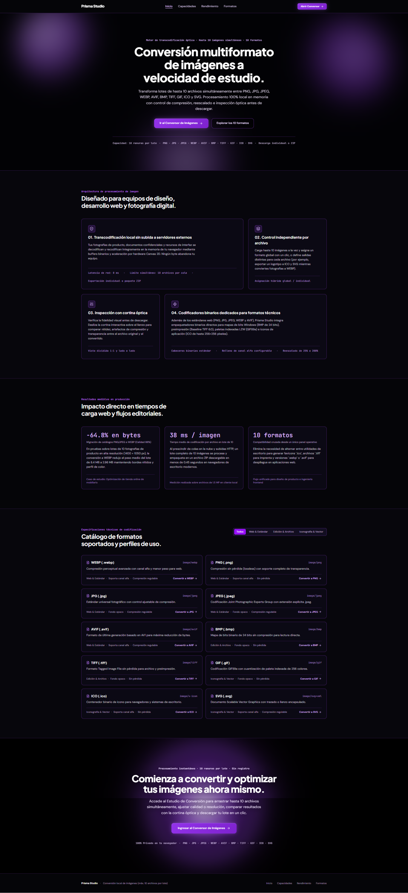

# Prisma Studio — Conversor de Imágenes Multiformato | Multi-Format Image Converter | Conversor de Imagens Multiformato

[](https://prismastudio-converter.falconit.xyz/)

👉 **Live URL / Demo en vivo:** [https://prismastudio-converter.falconit.xyz/](https://prismastudio-converter.falconit.xyz/)

🌐 **Idiomas / Languages / Idiomas:** [🇪🇸 Español](#español) · [🇺🇸 English](#english) · [🇧🇷 Português](#português)

---

## Vista Previa / Preview / Pré-visualização



---

<a id="español"></a>

# 🇪🇸 Español — Documentación Completa

**Prisma Studio** es una aplicación web multilingüe (**Español, Inglés y Portugués**) con estética **Cyberpunk (Negro Obsidiana y Morado Neón)** diseñada para convertir, optimizar, redimensionar e inspeccionar lotes de hasta **10 imágenes simultáneas** directamente en el navegador del usuario (100% *client-side*), sin necesidad de subir archivos a servidores externos.

## 1. Definición de la Aplicación

Prisma Studio permite transformar activos gráficos entre formatos web modernos, formatos de edición/imprenta sin pérdida y formatos de iconografía/vectoriales desde una interfaz unificada. La aplicación está dividida en dos vistas principales gestionadas mediante **React Router DOM**:

- **Página Principal (`/`)**: Landing page interactiva donde se presenta la arquitectura de procesamiento óptico, métricas reales de reducción de peso, y el catálogo técnico de los 10 formatos soportados con acceso directo al estudio conversor.
- **Estudio de Conversión (`/convertir`)**: Espacio de trabajo dedicado a la carga por lotes (máximo 10 imágenes simultáneas), configuración de parámetros ópticos, conversión individual o masiva, comparación visual antes/después y exportación individual o en paquete `.zip`.

## 2. Formatos Soportados y Motores de Codificación

| Formato | Extensión | MIME Type | Categoría | Transparencia | Compresión Regulable | Motor de Codificación |
| :--- | :--- | :--- | :--- | :--- | :--- | :--- |
| **WEBP** | `.webp` | `image/webp` | Web & Estándar | Sí (Canal Alfa) | Sí (10% – 100%) | Codificador nativo HTML5 Canvas WebP |
| **PNG** | `.png` | `image/png` | Web & Estándar | Sí (RGBA 32-bit) | Sin pérdida (Lossless) | Codificador nativo HTML5 Canvas PNG |
| **JPG** | `.jpg` | `image/jpeg` | Web & Estándar | No (Relleno configurable) | Sí (10% – 100%) | Codificador cromático JPEG con mate de fondo |
| **JPEG** | `.jpeg` | `image/jpeg` | Web & Estándar | No (Relleno configurable) | Sí (10% – 100%) | Codificador cromático JPEG con extensión `.jpeg` |
| **AVIF** | `.avif` | `image/avif` | Web & Estándar | Sí (Canal Alfa) | Sí (10% – 100%) | Codificador nativo AV1 con fallback de alta eficiencia |
| **BMP** | `.bmp` | `image/bmp` | Edición & Archivo | No | Sin pérdida (24-bit) | Empaquetador binario directo (`BITMAPFILEHEADER` + `BITMAPINFOHEADER`) |
| **TIFF** | `.tiff` | `image/tiff` | Edición & Archivo | No | Sin pérdida (RGB) | Empaquetador binario **Baseline TIFF 6.0** (Little-Endian `II` + IFD tags) |
| **GIF** | `.gif` | `image/gif` | Iconografía & Vector | No | Paleta indexada (256 col) | Codificador binario **GIF89a** con cuantización cúbica RGB y compresión **LZW** |
| **ICO** | `.ico` | `image/x-icon` | Iconografía & Vector | Sí (Canal Alfa) | Sin pérdida (32–256 px) | Contenedor binario Windows Icon (`ICONDIR` + `ICONDIRENTRY` + payload PNG) |
| **SVG** | `.svg` | `image/svg+xml` | Iconografía & Vector | Sí (Canal Alfa) | Sí (10% – 100%) | Generador XML `SVG 1.1` con `viewBox` escalable de precisión |

## 3. Funcionamiento Detallado del Flujo de Conversión

1. **Carga y Validación del Lote (Máximo 10 Imágenes)**: Arrastra y suelta archivos, selecciónalos desde tu dispositivo o pulsa **«Cargar 3 imágenes de prueba»**. El sistema controla el límite de 10 ranuras por lote (`0 / 10` a `10 / 10`).
2. **Selección de Formato (Global o Individual)**: Aplica cualquiera de los 10 formatos a todo el lote con un clic o elige un formato de salida distinto para cada archivo en la cola.
3. **Parámetros Ópticos y Geométricos**: Ajusta la calidad de codificación (`10%`–`100%`), escala de resolución (`25%`–`200%`), rotación (`90°`), volteo horizontal/vertical, filtros ópticos de color, color de relleno para formatos sin transparencia y tamaño de icono `.ico` (`32px`–`256px`).
4. **Inspección Óptica Antes / Después**: Compara el archivo original y el convertido mediante una **cortina deslizante interactiva** o vista **lado a lado**.
5. **Descarga Individual o en ZIP**: Descarga cada imagen convertida por separado o empaqueta todo el lote en un archivo `.zip` mediante `JSZip`.

---

<a id="english"></a>

# 🇺🇸 English — Complete Documentation

**Prisma Studio** is a multilingual web application (**Spanish, English, and Portuguese**) featuring a **Cyberpunk (Obsidian Black & Neon Purple)** aesthetic, engineered to convert, optimize, resize, and inspect batches of up to **10 simultaneous images** directly inside the user's browser (100% *client-side*), with zero external server uploads.

## 1. Application Overview

Prisma Studio streamlines transforming visual assets across modern web formats, lossless editing/prepress formats, and icon/vector containers from a single unified workspace. The app is structured into two routes powered by **React Router DOM**:

- **Landing Page (`/`)**: Interactive showcase presenting the optical processing architecture, production byte-reduction benchmarks, and the technical catalog of all 10 supported formats with instant links into the converter.
- **Conversion Studio (`/convertir`)**: Dedicated batch workspace (up to 10 simultaneous images) featuring optical parameter controls, individual or batch conversion, before/after visual comparison, and single-file or `.zip` archive export.

## 2. Supported Formats & Binary Encoding Engines

| Format | Extension | MIME Type | Category | Transparency | Adjustable Compression | Encoding Engine |
| :--- | :--- | :--- | :--- | :--- | :--- | :--- |
| **WEBP** | `.webp` | `image/webp` | Web & Standard | Yes (Alpha Channel) | Yes (10% – 100%) | Native HTML5 Canvas WebP Encoder |
| **PNG** | `.png` | `image/png` | Web & Standard | Yes (32-bit RGBA) | Lossless | Native HTML5 Canvas PNG Encoder |
| **JPG** | `.jpg` | `image/jpeg` | Web & Standard | No (Configurable Matte) | Yes (10% – 100%) | Chromatic JPEG Encoder with background fill |
| **JPEG** | `.jpeg` | `image/jpeg` | Web & Standard | No (Configurable Matte) | Yes (10% – 100%) | Chromatic JPEG Encoder with `.jpeg` extension |
| **AVIF** | `.avif` | `image/avif` | Web & Standard | Yes (Alpha Channel) | Yes (10% – 100%) | Native AV1 Encoder with high-efficiency fallback |
| **BMP** | `.bmp` | `image/bmp` | Editing & Archive | No | Lossless (24-bit) | Direct binary packager (`BITMAPFILEHEADER` + `BITMAPINFOHEADER`) |
| **TIFF** | `.tiff` | `image/tiff` | Editing & Archive | No | Lossless (RGB) | Direct binary **Baseline TIFF 6.0** packager (Little-Endian `II` + IFD tags) |
| **GIF** | `.gif` | `image/gif` | Icons & Vector | No | Indexed Palette (256 col) | Binary **GIF89a** encoder with cubic RGB quantization & **LZW** compression |
| **ICO** | `.ico` | `image/x-icon` | Icons & Vector | Yes (Alpha Channel) | Lossless (32–256 px) | Binary Windows Icon container (`ICONDIR` + `ICONDIRENTRY` + PNG payload) |
| **SVG** | `.svg` | `image/svg+xml` | Icons & Vector | Yes (Alpha Channel) | Yes (10% – 100%) | Precision `SVG 1.1` XML generator with scalable `viewBox` |

## 3. Detailed Conversion Workflow

1. **Batch Upload & Validation (Up to 10 Images)**: Drag and drop files, browse from your device, or click **“Load 3 sample images”**. The queue enforces a strict 10-slot capacity (`0 / 10` to `10 / 10`).
2. **Global or Per-File Format Selection**: Assign any of the 10 target formats to the entire batch in one click, or customize the output format individually per queued file.
3. **Optical & Geometric Parameters**: Fine-tune encoding quality (`10%`–`100%`), resolution scaling (`25%`–`200%`), `90°` rotation steps, horizontal/vertical flips, pixel-level color filters, alpha matte fill color for opaque formats, and `.ico` dimensions (`32px`–`256px`).
4. **Before / After Optical Inspection**: Compare the original and converted images using the **interactive split curtain** or **side-by-side** inspector modal.
5. **Single or Batch ZIP Download**: Download each converted image individually or package all completed files into a single `.zip` archive powered by `JSZip`.

---

<a id="português"></a>

# 🇧🇷 Português — Documentação Completa

**Prisma Studio** é uma aplicação web multilíngue (**Espanhol, Inglês e Português**) com estética **Cyberpunk (Preto Obsidiana e Roxo Neon)** projetada para converter, otimizar, redimensionar e inspecionar lotes de até **10 imagens simultâneas** diretamente no navegador do usuário (100% *client-side*), sem necessidade de enviar arquivos para servidores externos.

## 1. Definição da Aplicação

O Prisma Studio permite transformar ativos gráficos entre formatos web modernos, formatos de edição/impressão sem perdas e formatos de iconografia/vetoriais a partir de uma interface unificada. A aplicação é dividida em duas rotas principais gerenciadas pelo **React Router DOM**:

- **Página Inicial (`/`)**: Landing page interativa que apresenta a arquitetura de processamento óptico, métricas reais de redução de tamanho e o catálogo técnico dos 10 formatos suportados com acesso direto ao estúdio conversor.
- **Estúdio de Conversão (`/convertir`)**: Espaço de trabalho dedicado ao carregamento em lote (máximo de 10 imagens simultâneas), configuração de parâmetros ópticos, conversão individual ou em massa, comparação visual antes/depois e exportação individual ou em pacote `.zip`.

## 2. Formatos Suportados e Motores de Codificação

| Formato | Extensão | MIME Type | Categoria | Transparência | Compressão Ajustável | Motor de Codificação |
| :--- | :--- | :--- | :--- | :--- | :--- | :--- |
| **WEBP** | `.webp` | `image/webp` | Web & Padrão | Sim (Canal Alfa) | Sim (10% – 100%) | Codificador nativo HTML5 Canvas WebP |
| **PNG** | `.png` | `image/png` | Web & Padrão | Sim (RGBA 32-bit) | Sem perdas (Lossless) | Codificador nativo HTML5 Canvas PNG |
| **JPG** | `.jpg` | `image/jpeg` | Web & Padrão | Não (Fundo configurável) | Sim (10% – 100%) | Codificador cromático JPEG com preenchimento de fundo |
| **JPEG** | `.jpeg` | `image/jpeg` | Web & Padrão | Não (Fundo configurável) | Sim (10% – 100%) | Codificador cromático JPEG com extensão `.jpeg` |
| **AVIF** | `.avif` | `image/avif` | Web & Padrão | Sim (Canal Alfa) | Sim (10% – 100%) | Codificador nativo AV1 com fallback de alta eficiência |
| **BMP** | `.bmp` | `image/bmp` | Edição & Arquivo | Não | Sem perdas (24-bit) | Empacotador binário direto (`BITMAPFILEHEADER` + `BITMAPINFOHEADER`) |
| **TIFF** | `.tiff` | `image/tiff` | Edição & Arquivo | Não | Sem perdas (RGB) | Empacotador binário **Baseline TIFF 6.0** (Little-Endian `II` + IFD tags) |
| **GIF** | `.gif` | `image/gif` | Iconografia & Vetor | Não | Paleta indexada (256 cores) | Codificador binário **GIF89a** com quantização cúbica RGB e compressão **LZW** |
| **ICO** | `.ico` | `image/x-icon` | Iconografia & Vetor | Sim (Canal Alfa) | Sem perdas (32–256 px) | Contêiner binário Windows Icon (`ICONDIR` + `ICONDIRENTRY` + payload PNG) |
| **SVG** | `.svg` | `image/svg+xml` | Iconografia & Vetor | Sim (Canal Alfa) | Sim (10% – 100%) | Gerador XML `SVG 1.1` com `viewBox` escalável de precisão |

## 3. Funcionamento Detalhado do Fluxo de Conversão

1. **Carregamento e Validação do Lote (Máximo de 10 Imagens)**: Arraste e solte arquivos, selecione-os do seu dispositivo ou clique em **«Carregar 3 imagens de teste»**. O sistema controla o limite de 10 espaços por lote (`0 / 10` a `10 / 10`).
2. **Seleção de Formato (Global ou Individual)**: Aplique qualquer um dos 10 formatos a todo o lote com um clique ou escolha um formato de saída diferente para cada arquivo na fila.
3. **Parâmetros Ópticos e Geométricos**: Ajuste a qualidade de codificação (`10%`–`100%`), escala de resolução (`25%`–`200%`), rotação (`90°`), inversão horizontal/vertical, filtros ópticos de cor, cor de preenchimento para formatos sem transparência e tamanho de ícone `.ico` (`32px`–`256px`).
4. **Inspeção Óptica Antes / Depois**: Compare o arquivo original e o convertido por meio de uma **cortina deslizante interativa** ou visualização **lado a lado**.
5. **Download Individual ou em ZIP**: Baixe cada imagem convertida separadamente ou empacote todo o lote em um arquivo `.zip` usando `JSZip`.

---

## Estructura del Proyecto / Project Structure / Estrutura do Projeto

```text
/
├── public/
│   ├── favicon.svg                  # Favicon vectorial con prisma óptico neón
│   └── assets/aistudio/             # Captura de vista previa de la aplicación
├── index.html                       # Metadatos SEO, OpenGraph, Twitter Cards y JSON-LD
├── metadata.json                    # Configuración y descripción de la aplicación
├── README.md                        # Documentación trilingüe (Español, English, Português)
└── src/
    ├── App.tsx                      # Proveedor de idioma y rutas con React Router DOM
    ├── index.css                    # Tema Cyberpunk (negro obsidiana + morado neón)
    ├── main.tsx                     # Punto de entrada de React 19
    ├── context/
    │   └── LanguageContext.tsx      # Estado reactivo y persistencia de idioma (ES / EN / PT)
    ├── i18n/
    │   └── translations.ts          # Diccionario completo en Español, Inglés y Portugués
    ├── components/
    │   ├── Navbar.tsx               # Barra superior con selector de idioma y CTA
    │   └── ImageCompareModal.tsx    # Inspector comparativo con cortina deslizante
    ├── pages/
    │   ├── LandingPage.tsx          # Página principal (Ruta "/")
    │   └── ConverterPage.tsx        # Estudio de conversión de hasta 10 imágenes (Ruta "/convertir")
    └── utils/
        └── imageConverter.ts        # Motores de codificación binaria y filtros ópticos
```
